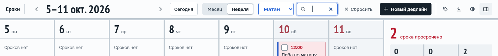
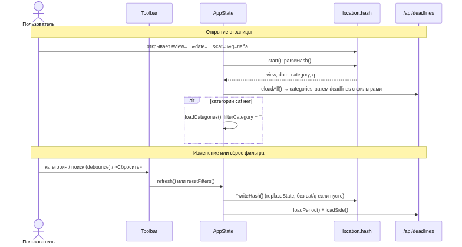
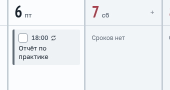
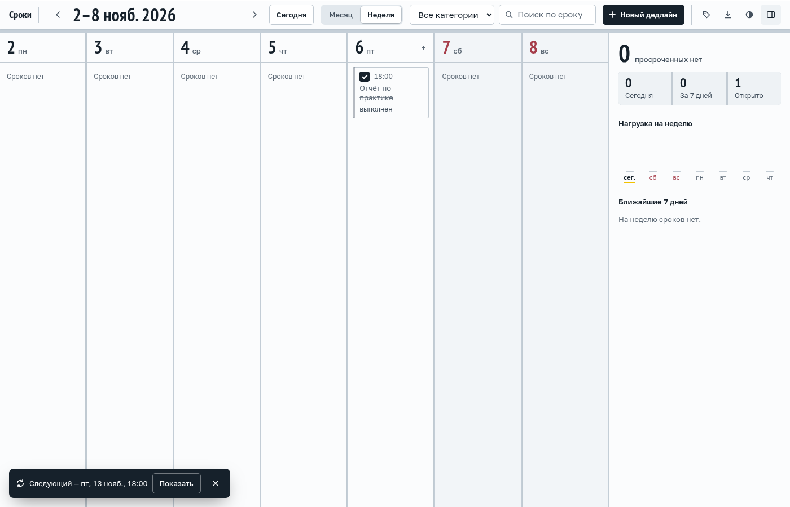
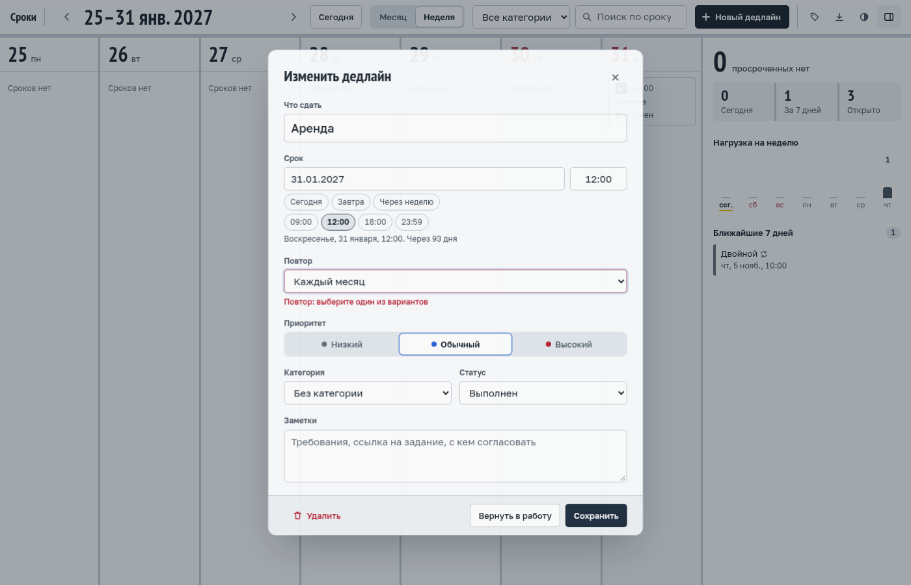

# REPORT: практика 5, Spec-Driven Development в brownfield

Проект — копия «Сроков» из практики 4 (`project/`: Python stdlib + SQLite, Svelte 5 + Vite).
Агент — Claude Code, решения по поведению принимал человек.

```
practice_05/
├── REPORT.md, reflection.md
├── media/          скриншоты и демо
├── e2e/            сквозные проверки в chromium (puppeteer-core)
└── project/
    ├── openspec/   классная работа: specs/, changes/archive/, changes/add-filters-in-url
    ├── .specify/   Spec Kit: constitution, шаблоны, скрипты
    └── specs/      ДЗ: 001-recurring-logic, 002-recurring-ui, contracts/recurring.md
```

## 1. Классная работа: OpenSpec 1.14.1

**Фича «Сбросить фильтры», полный цикл:**

| Шаг | Что сделано | Коммит |
|---|---|---|
| init | `openspec init --tools claude --profile core --language ru` через `npx` | `535b6bf` |
| explore → propose | proposal, spec (3 требования, 7 сценариев), design, tasks; `validate --strict` проходит | `535b6bf` |
| review → apply | человек одобрил; `hasActiveFilters()`, `resetFilters()`, кнопка отменяет отложенный поиск | `eabd27b` |
| проверки | vitest 46, Python 74, svelte-check 0, браузер **11/11** (`e2e/reset-filters.mjs`) | — |
| archive | создан main spec `openspec/specs/deadline-filters/spec.md` | `fdfe257` |

Самый полезный сценарий spec — «Сброс во время набора»: без него debounce отправил бы старый
запрос уже после сброса. В браузере проверено перехватом запросов.



**Правило для design.** Change `add-filters-in-url` остановлен до apply, его delta-спека
меняет требование из части 1 (`MODIFIED`). В `config.yaml` добавлено
`rules.design: Объясни взаимодействие диаграммой Mermaid.`, design перегенерирован с
sequence-диаграммой. До/после: `git diff fdfe257 2a85f97`. При рендере пропадали подписи с `#`,
исправлено на `#35;`.



## 2. ДЗ: «Две команды — одна фича» на Spec Kit 1.2.5

**Фреймворк.** Spec Kit (github/spec-kit) — его советовали на практике. Установлен из GitHub:
`uvx --from git+https://github.com/github/spec-kit.git@v1.2.5 specify init --here --integration claude --script sh`.
Constitution: только stdlib, единый формат ошибок, тесты на новую логику, миграции через
`user_version`, расхождения решает человек (`8756fe0`).

**Две команды** — два агента с изолированным контекстом (вместо двух чатов). Обе получили одну
фразу заказчика: «у дедлайна можно задать повтор; когда повторяющийся отмечают выполненным,
появляется следующий». Спеку другой команды они не видели.

| | Команда 1 — UI | Команда 2 — логика |
|---|---|---|
| Спека | `specs/002-recurring-ui`: 4 истории, 17 FR, 6 SC | `specs/001-recurring-logic`: 4 истории, 13 FR, 5 SC |
| Черновик контракта | `contracts/ui-needs.md` — что UI ждёт от API | `contracts/api.md` — модель, эндпоинты, ошибки |

Чтобы две фичи шли параллельно, каждой команде задан `SPECIFY_FEATURE_DIRECTORY` и
`SPECIFY_FEATURE_NO_PERSIST=1`: иначе Spec Kit хранит активную фичу в общем `feature.json`.

**Спеки «до»** — коммит `57b1973`.

### Общий контракт — `specs/contracts/recurring.md`

| # | Расхождение | Решение | Кто |
|---|---|---|---|
| R1 | UI: день/неделя/месяц; логика: ещё и год | `daily/weekly/monthly/yearly` | человек |
| R2 | UI ждёт объект `next`, логика отдаёт `next_id`; по `next_id` UI показывал бы сообщение при каждой отметке | `next_id` у дедлайна + `next` в ответе PATCH, только если создан этим запросом | человек |
| R3 | Опоздание: логика пропускала периоды, UI вопрос не поднимал | один шаг от срока | человек |
| R4 | Снятие отметки (у обеих `NEEDS CLARIFICATION`) | следующий остаётся, дубля нет | человек |
| R5 | Текст ошибки: коды vs текст для пользователя | «Повтор: выберите один из вариантов» | оркестратор |
| R6 | UI допускал `next` при POST со статусом `done` | POST следующий не создаёт | оркестратор |

Команды сами обновили спеки (Clarifications, все маркеры неясностей закрыты). Команда логики
нашла противоречие в самом контракте («открытый экземпляр всегда один» против R4), оно исправлено.

**Спеки «после» и контракт** — `df925e6`; разница: `git diff 57b1973 df925e6 -- project/specs`.

### Реализация

По `plan.md` → `tasks.md` (`45050d0`), все задачи отмечены `[x]`.

- **Логика** (`a2b7463`, тесты написаны до кода): миграция 2 (`recurrence`, `recurrence_day`,
  `next_id`); `next_due()` — 31.01 → 28.02 → 31.03, 29.02 → 28.02 → … → 29.02; отметка и создание
  следующего в одной транзакции.
- **UI** (`09db1d4`): поле «Повтор» с ошибкой по `field`; значок и озвучка повтора; сообщение
  `NextNotice` (`role=status`, 8 с, Esc, «Показать»); флажок блокируется через `aria-disabled`,
  чтобы не терять фокус.

| | |
|---|---|
|  |  |

### Проверки

| Проверка | Результат |
|---|---|
| Python unittest / pyright | **91 OK** (было 74) / 0 ошибок |
| vitest / svelte-check / build | 49 passed / 0 ошибок / OK |
| `e2e/run.sh recurring.mjs` — сквозной сценарий | **16/16** |
| `e2e/run.sh reset-filters.mjs` — регрессия | 11/11 |

Сквозной сценарий проверяет:
- основной путь: создание → отметка → «Следующий — пт, 13 нояб.» → «Показать»; снятие → «…остался»; без дублей, в том числе при двойном клике;
- **граница**: 31.01 «каждый месяц» → 28 февр.;
- **ошибки**: неверный повтор → `400` под полем с фокусом; обрыв связи → флажок откатывается, на сервере ничего не создано.

Два падения по ходу были ошибками в самих тестах, а не в коде.



**Демо:** [`media/hw-demo.mp4`](media/hw-demo.mp4), 10 с — записано тем же сценарием.
Запуск: `cd e2e && ./run.sh recurring.mjs ../media`.

### Сравнение Spec Kit и OpenSpec

| | OpenSpec | Spec Kit |
|---|---|---|
| Единица работы | change — delta к живым specs, затем archive | фича `NNN-name/` с полным набором документов |
| Brownfield | main spec копит поведение, `MODIFIED` меняет старое | каждая фича с нуля, общего описания системы нет |
| Неясности | в explore или в чате | `[NEEDS CLARIFICATION]`, `clarify`, раздел Clarifications |
| Проверка | `validate --strict` (CLI) | чек-лист, который заполняет модель |
| Контракты | отдельного артефакта нет | `contracts/` в plan |
| Принципы | `config.yaml`: `context`, `rules` | `constitution.md` + Constitution Check |
| Объём | ~120 строк на фичу | ~890 строк на две фичи |
| Параллельность | changes лежат рядом | нужны переменные окружения |

**Вывод:** OpenSpec легче и лучше для brownfield и маленьких правок. Spec Kit тяжелее, но для
договорённости двух сторон дал больше: маркеры неясностей сразу показали спорные места (R3, R4),
а `contracts/` дал место общему контракту.
