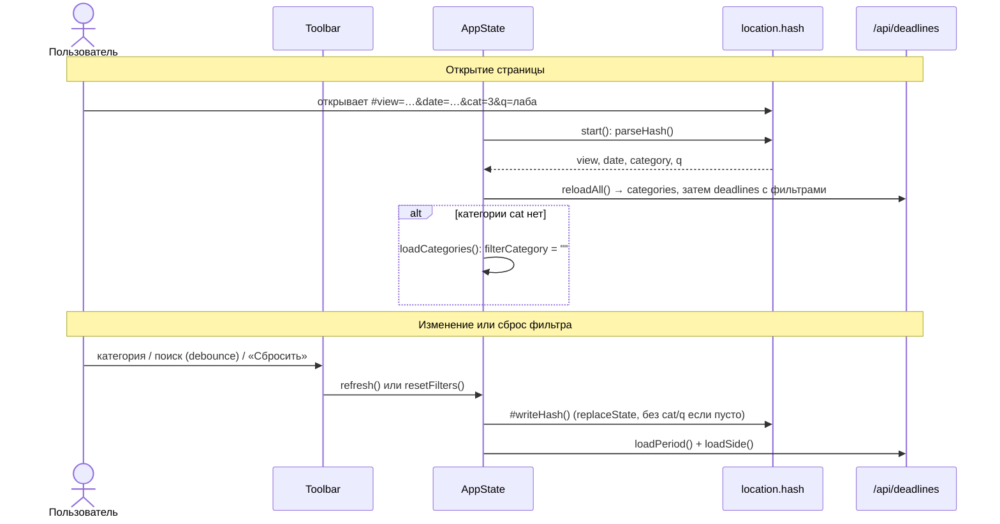

# Design

## Context

Хэш пишет `AppState.#writeHash()` через `history.replaceState` при каждом изменении вида или
даты; читает его только `start()` через `parseHash`. Слушателя `hashchange` нет. Фильтры
меняются в `Toolbar` и применяются вызовом `app.refresh()`.

## Goals / Non-Goals

**Goals:** фильтры переживают перезагрузку и передаются ссылкой.

**Non-Goals:** реакция на ручную правку хэша без перезагрузки (`hashchange`), история браузера.

## Decisions

- `Route` расширяется полями `category` и `q`; `parseHash`/`formatHash` остаются чистыми
  функциями и покрываются vitest. Альтернатива — отдельный модуль для фильтров — дублирует
  разбор `URLSearchParams`.
- Запись: `refresh()` вызывает `#writeHash()` перед загрузкой, поэтому хэш обновляется в
  одной точке для поиска, категории и сброса. `replaceState`, а не `pushState`, чтобы каждая
  буква поиска не создавала запись в истории.
- Чтение: `start()` берёт фильтры из хэша до первого `reloadAll()`; проверка существования
  категории — уже существующая ветка в `loadCategories()`.

## Risks / Trade-offs

- [Кириллица в `q` кодируется в адресе] → `URLSearchParams` кодирует и декодирует сам.
