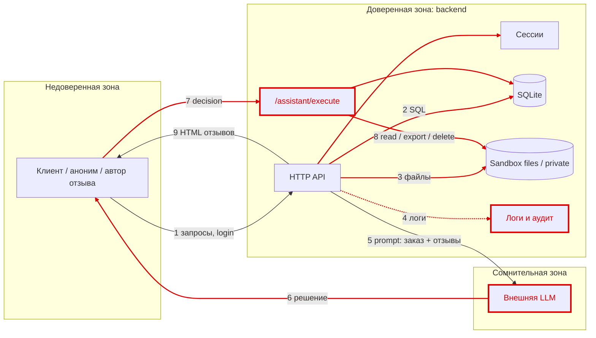

# Модель угроз магазина (STRIDE)

**Активы:** ПДн клиентов (152-ФЗ), заказы и цены, чеки, `private/operator-note.txt`, токены и пароли.

Красным отмечены узлы и потоки с найденными угрозами.

| ID | STRIDE | Поток | Угроза | Мера |
|---|---|---|---|---|
| T0 | Spoofing | 1 | Перебор паролей, бессрочные токены | Лимит 5 неудач/60 с, TTL 1 ч, ≤1000 сессий |
| T1 | Tampering, Info | 2 | SQLi в `/profile`, `/search`, `/assistant/context` | Параметры `?`, `int()` |
| T2 | Info | 2, 3 | IDOR: чужие профиль, заказы, чеки | Проверка владельца по сессии |
| T3 | EoP | 1 | Роль из заголовка `X-Role` | Роль только из сессии |
| T4 | Tampering | 1 | Цена от клиента | Цена из каталога |
| T5 | Info | 3 | Path traversal (`private/`, чужие каталоги) | Привязка к `files/<свой user>/` |
| T6 | Info | 4 | Открытый debug-лог с паролями и токенами | Только staff, без body/headers |
| T7 | Tampering | 9 | XSS, отзывы без логина | `html.escape`, логин, лимиты |
| T8 | EoP | 5–7 | Prompt injection, выполнение любого решения | Решение = недоверенный ввод, allow-list, права из сессии |
| T9 | Info, DoS | 8 | Анонимные `export_profiles`, `delete_tree` | export только staff, delete закрыт |
| T10 | Info | все | Детали исключений в 500 | Общие сообщения |
| T11 | Info | 5 | ПДн во внешней LLM | В prompt только заказ |
| T12 | DoS | 4 | Неограниченные логи и отзывы | Лимиты размера и числа |
| T13 | Repudiation | 6–8 | Действия агента без автора | `/audit`: пользователь, инструмент, статус |

## Категории без угроз

| Элемент | Нет угроз | Почему |
|---|---|---|
| SQLite | Spoofing, DoS | Доступ только у backend, запросы параметризованы |
| Sandbox | Spoofing, Tampering | Записи через API нет, `delete_tree` закрыт |
| Сессии | Tampering | Токен uuid4, роль только на сервере |

## Принципы

1. Вывод LLM — недоверенный ввод, сервер проверяет его как запрос пользователя.
2. Права берутся из сессии, а не из текста.
3. Клиенту доступен только `read_file` для своего чека.
